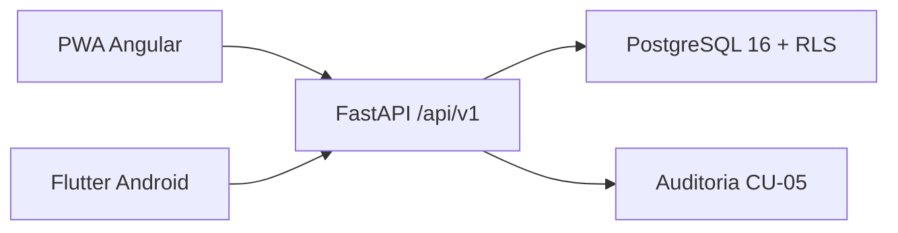
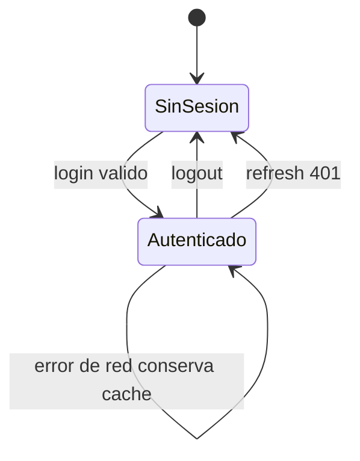

# CU-01 a CU-04 en PWA Angular y Android Flutter

Este documento describe la implementacion de los casos de uso de cliente sobre
la misma API FastAPI. CU-05 permanece en backend: ambos clientes generan
auditoria a traves de las llamadas HTTP existentes.

## Alcance

| CU | PWA Angular | Android Flutter |
|---|---|---|
| CU-01 Iniciar sesion | `/login` | `/login` |
| CU-02 Registrarse | `/register` | `/register` |
| CU-02 Verificar correo | `/verify-email` | `/verify-email` |
| CU-03 Gestionar perfil | `/profile` | `/profile` |
| CU-04 Cerrar sesion | Dialogo en shell y perfil | Dialogo en perfil |

CU-03 no incluye direcciones. El perfil editable se limita a nombre y telefono;
la seguridad permite cambiar contrasena y el estado de cuenta es de solo
lectura.

## Arquitectura de clientes



### PWA

- Angular 20 standalone con Service Worker y manifest.
- `AuthService` centraliza sesion, expiracion, tenant y permisos de escritura.
- `auth.interceptor.ts` agrega Bearer, intenta refresh una vez ante `401` y
  distingue errores de red.
- `SessionStoreService` guarda tokens, usuario, tenant y expiracion en
  `localStorage` con claves `fs_*`.
- `NetworkService` expone el estado online/offline; `ErrorMapper` traduce
  `detail.code` y errores HTTP a mensajes de interfaz.
- `ngsw-config.json` cachea el shell y assets, pero no las respuestas de
  `/api/v1/**`.
- `InstallService` y el aviso de actualizacion cubren la experiencia PWA.

### Flutter

- `go_router` con redireccion por estado de sesion y rutas protegidas.
- `SessionController extends ChangeNotifier`; no se usa Riverpod.
- `Dio` con interceptor Bearer, refresh single-flight y reintento de la peticion
  original. Un `401` definitivo limpia la sesion; un fallo de red no.
- `flutter_secure_storage` guarda access token, refresh token y expiracion.
- `sqflite` guarda usuario, tenant, ultima sincronizacion y cola offline.
- `connectivity_plus` actualiza el estado de red y deshabilita escrituras sin
  conexion.
- `AppConfig` toma `API_BASE_URL` desde `--dart-define`.

## Contrato usado

| Metodo | Ruta | Uso |
|---|---|---|
| POST | `/api/v1/auth/login` | CU-01 |
| POST | `/api/v1/auth/refresh` | Renovacion de sesion |
| POST | `/api/v1/auth/logout` | CU-04 |
| POST | `/api/v1/auth/register` | CU-02 |
| POST | `/api/v1/auth/verify-email` | CU-02 |
| GET | `/api/v1/users/me` | CU-03 |
| PATCH | `/api/v1/users/me` | CU-03 |
| POST | `/api/v1/users/me/password` | CU-03 |

Los errores de negocio se esperan como:

```json
{"detail": {"code": "EMAIL_NOT_VERIFIED", "message": "Verifique su correo"}}
```

Se manejan de forma especial `401`, `402`, `403`, `429` y los errores de red.
El login incluye `empresa_slug` porque el correo es unico por empresa.

## Flujo de sesion



En Flutter, el arranque lee tokens seguros y cache SQLite. Si hay access token
pero no usuario cacheado, intenta `GET /users/me`. Si la sesion expiro y hay
red, intenta refresh; si no hay red, conserva la sesion local y muestra un aviso.

## Comportamiento offline

| Accion | PWA | Flutter |
|---|---|---|
| Ver perfil cacheado | Si | Si |
| Iniciar sesion | No | No |
| Registrar o verificar | No | No |
| Editar perfil o contrasena | No | No |
| Cerrar sesion local | Si | Si |
| Conservar cola offline | Si | Si |

El logout elimina solo credenciales y usuario cacheado. No borra el tenant ni
`operacion_pendiente`, por lo que las operaciones pendientes sobreviven al
cierre de sesion.

## Configuracion y ejecucion

### PWA

```powershell
.\scripts\run_backend.ps1
.\scripts\run_frontend.ps1
```

`frontend/proxy.conf.json` envia `/api` a `http://127.0.0.1:8000`. Para probar la
PWA desde otro dispositivo de la red, iniciar Angular con
`.\scripts\run_frontend.ps1 -BindHost 0.0.0.0` y servir por HTTPS para que el
Service Worker y la instalacion funcionen fuera de `localhost`.

### Android

```powershell
.\scripts\run_backend.ps1 -BindHost 0.0.0.0
.\scripts\run_mobile.ps1
```

El valor por defecto es `http://10.0.2.2:8000/api/v1`, que apunta al host desde
el emulador Android. Para un dispositivo fisico:

```powershell
.\scripts\run_mobile.ps1 `
  -ApiBaseUrl http://192.168.1.10:8000/api/v1 `
  -Device <device-id>
```

El manifest debug habilita cleartext HTTP solo para desarrollo. El manifest
principal declara `INTERNET` y el proyecto usa el `minSdk` del SDK Flutter, que
es compatible con `flutter_secure_storage`. En iOS se agrego
`NSAllowsLocalNetworking`, pero iOS no se compila en Windows.

## Pruebas ejecutadas

```powershell
cd mobile
flutter analyze
flutter test
```

La suite Flutter cubre parseo de respuestas, cache SQLite y validacion del login.
Resultado actual: 6 pruebas aprobadas. `flutter analyze` no reporta errores.

```powershell
cd mobile
flutter build apk --debug
```

Resultado actual: APK debug generado en
`mobile/build/app/outputs/flutter-apk/app-debug.apk`. `flutter doctor` advierte
que faltan `cmdline-tools` y licencias, pero Gradle pudo compilar con el SDK
instalado.

```powershell
cd frontend
npm run build
```

La PWA compila en modo produccion con Service Worker.

## Limitaciones conocidas

- La PWA mantiene credenciales en `localStorage`; una migracion a IndexedDB no
  forma parte de CU-01..CU-04.
- Flutter no implementa biometria, notificaciones push ni enlaces profundos.
- La cola offline existente se conserva, pero CU-01..CU-04 no agregan nuevas
  operaciones de escritura offline.
- El token de verificacion solo aparece en la respuesta de registro cuando el
  backend esta en modo demo.
- `flutter doctor` recomienda instalar Android `cmdline-tools` y aceptar
  licencias; el APK debug ya compila, pero falta probarlo en emulador o
  dispositivo fisico.
