# CU-01 a CU-05: análisis ICONIX, robustez, secuencias y clases

Este documento complementa `MODELO_FINAL_FASHIONSTORE.md` y registra el diseño
que respalda la implementación del backend FastAPI y del frontend Angular.

## 1. Modelo de dominio del alcance

| Entidad | Tabla | Rol en el alcance |
|---|---|---|
| Empresa | `empresa` | Tenant resuelto por `slug`; su estado condiciona el acceso. |
| Plan | `plan` | Plan contratado; define límites y funciones habilitadas. |
| Suscripción | `suscripcion` | Estado y vigencia que habilitan el login. |
| Rol | `rol` | Rol del usuario (`superadmin`, `administrador`, `cajero`, `encargado`, `cliente`). |
| Usuario | `usuario` | Credenciales, estado, verificación de correo y último acceso. |
| Sesión | `sesion` | Refresh token hasheado, expiración y revocación. |
| Verificación de correo | `verificacion_correo` | Token hasheado, expiración y confirmación (CU-02). |
| Bitácora | `bitacora_auditoria` | Registro inmutable y particionado (CU-05). |
| Operación pendiente | `operacion_pendiente` | Cola offline local; el logout no la elimina (CU-04). |

Relaciones principales:

- `empresa` 1:N `usuario`, `rol`, `suscripcion`, `sesion`.
- `usuario` 1:N `sesion`, `verificacion_correo`.
- `rol` 1:N `usuario`; `rol` N:M `permiso` mediante `rol_permiso`.
- `suscripcion` N:1 `plan`.
- `bitacora_auditoria` referencia `empresa`, `empresa_afectada` y `usuario`.

## 2. Diagramas de robustez

### CU-01 Iniciar sesión

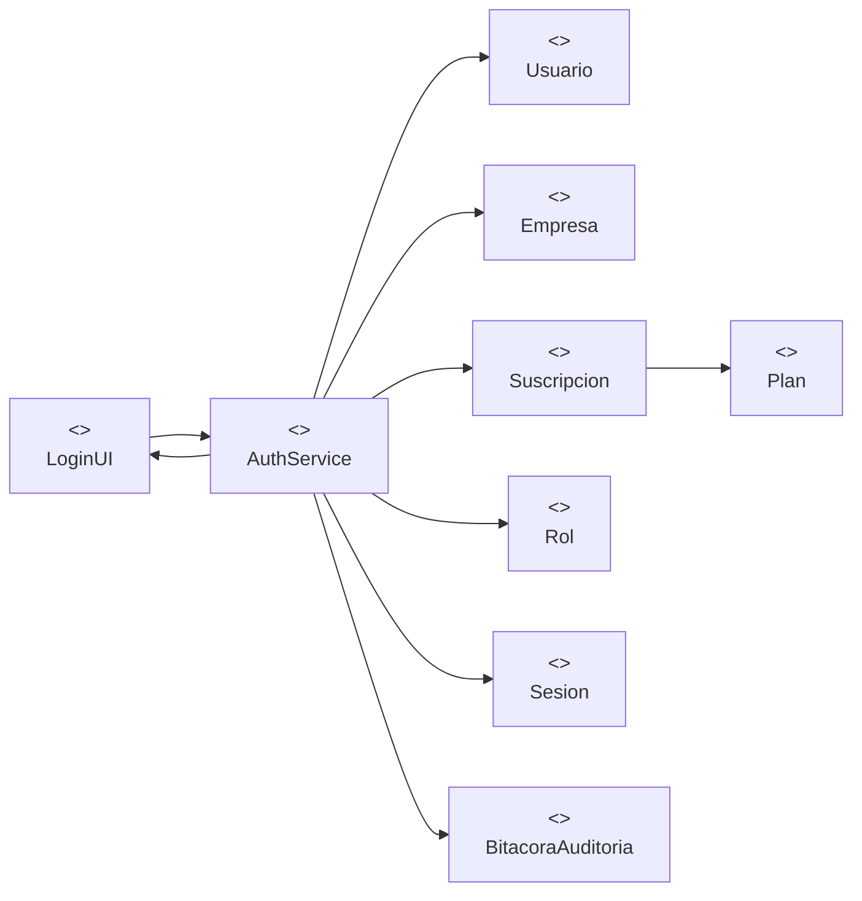

Validaciones: tenant por `empresa_slug`, usuario activo, correo verificado,
empresa activa, suscripción `prueba`/`activa` y vigente, contraseña bcrypt.

### CU-02 Registrarse

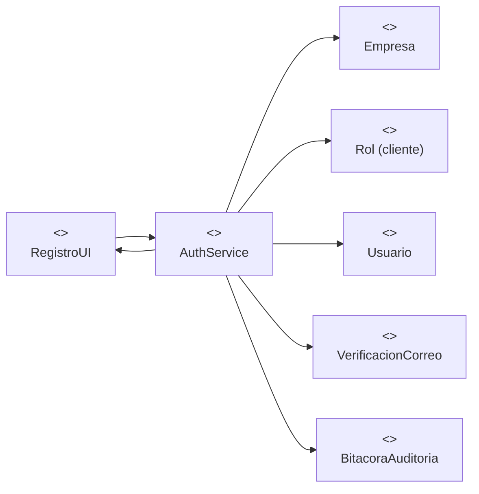

El usuario se crea con `email_verificado = false`; el login se bloquea hasta
confirmar el token de `verificacion_correo`.

### CU-03 Gestionar perfil

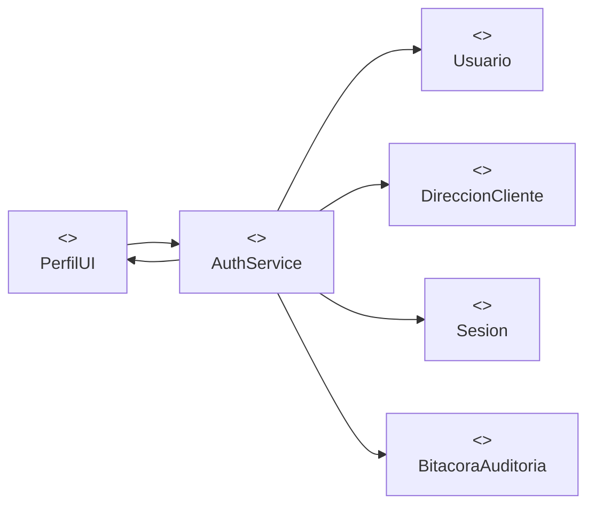

`GET/PATCH /users/me` operan sobre `usuario`. La dirección vive en
`direccion_cliente` y no se mezcla con la tabla de credenciales.

### CU-04 Cerrar sesión

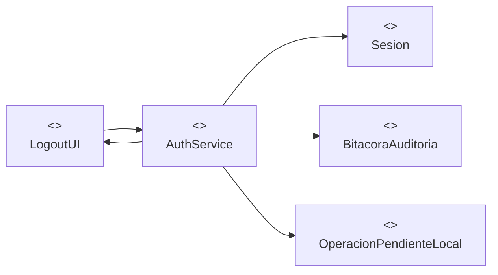

El servidor marca `sesion.revocado_en`; el cliente elimina solo las claves de
autenticación y conserva la cola offline.

### CU-05 Registrar auditoría

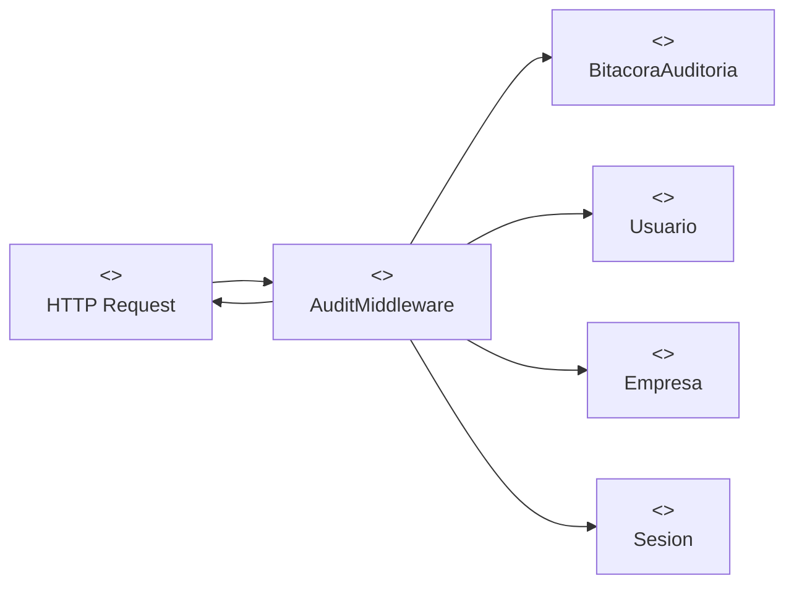

Los triggers `fn_audit_row()` registran cambios de fila. El middleware registra
solicitudes HTTP, login/logout/export y acciones de superadmin, con
`es_accion_superadmin` y parámetros redactados.

## 3. Diagramas de secuencia

### CU-01 Login

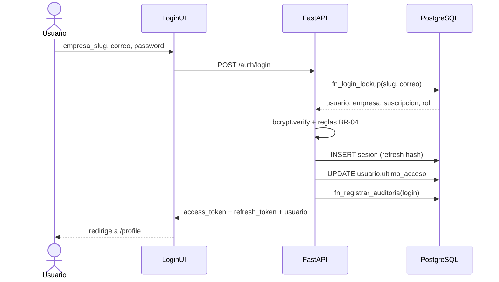

### CU-02 Registro y verificación

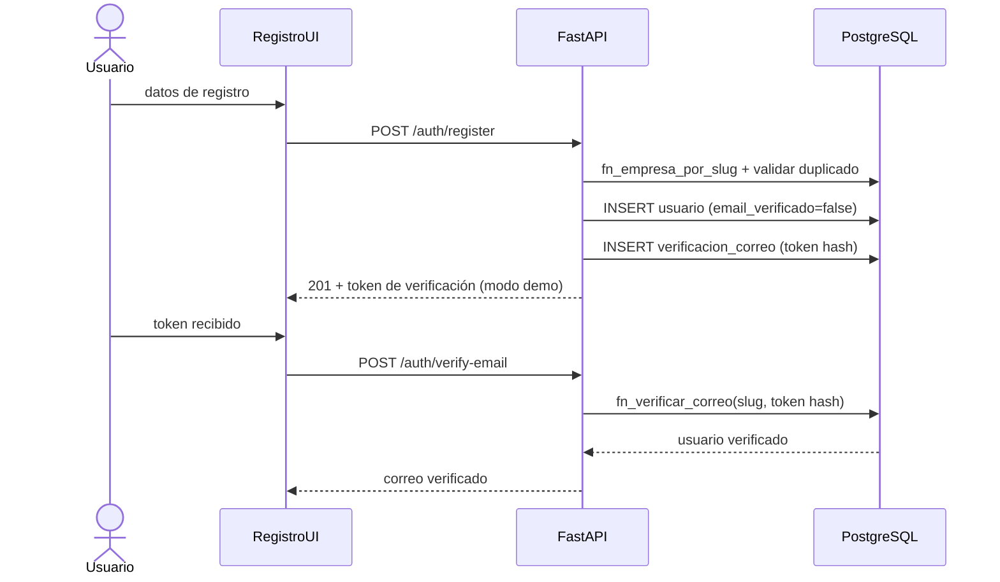

### CU-03 Perfil y cambio de contraseña

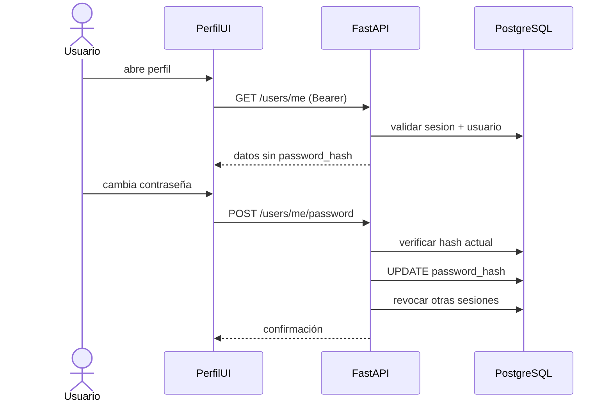

### CU-04 Logout

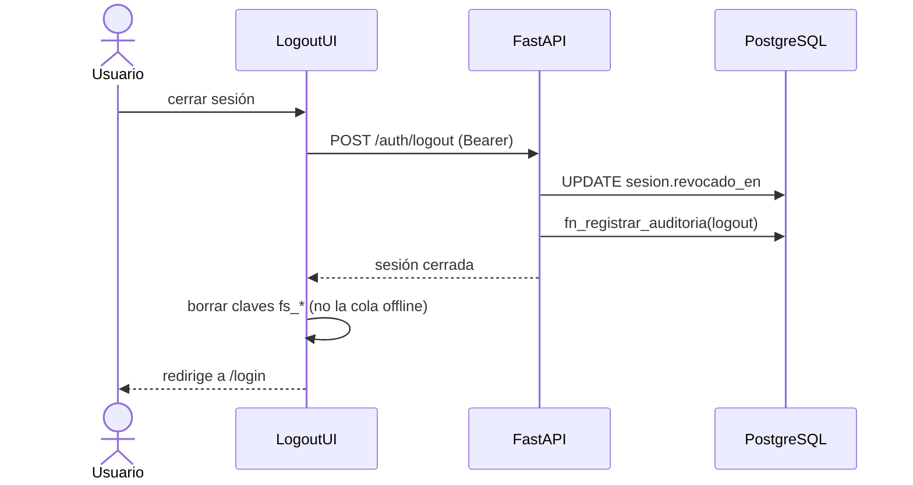

### CU-05 Auditoría transversal

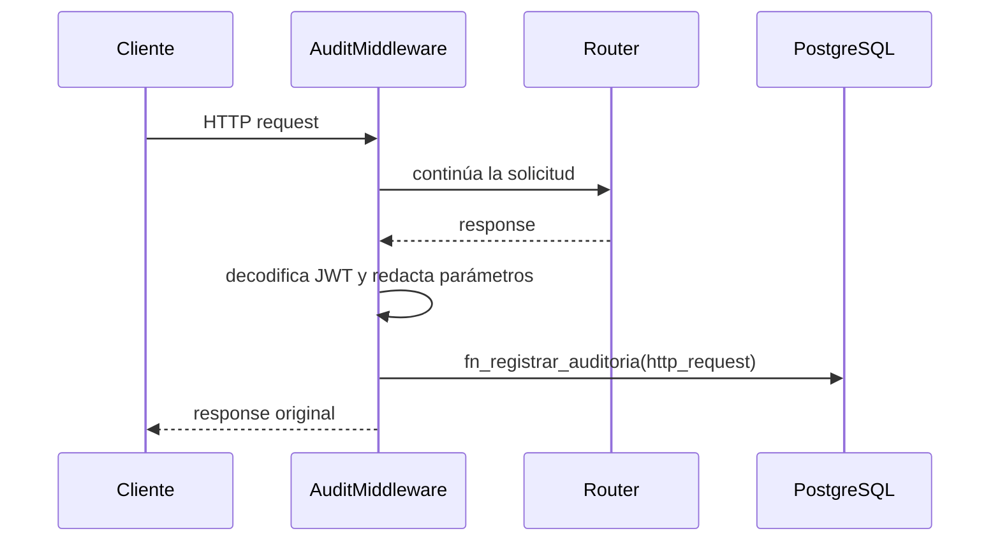

## 4. Modelo de clases de la implementación

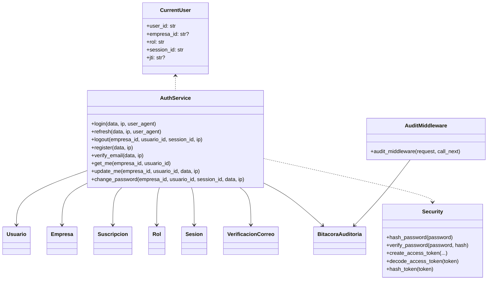

## 5. Mapeo a la base de datos

| Operación | Tablas / funciones |
|---|---|
| Resolver tenant | `empresa`, `fn_empresa_por_slug()` |
| Autenticar | `usuario`, `rol`, `suscripcion`, `plan`, `fn_login_lookup()` |
| Crear sesión | `sesion` |
| Registrar | `usuario`, `rol`, `verificacion_correo` |
| Verificar correo | `fn_verificar_correo()` |
| Perfil | `usuario` (y `direccion_cliente` si se amplía) |
| Logout | `sesion.revocado_en` |
| Auditoría | `bitacora_auditoria`, `fn_registrar_auditoria()` |

## 6. Interfaces

### Backend

| Método | Ruta | CU |
|---|---|---|
| POST | `/api/v1/auth/login` | CU-01 |
| POST | `/api/v1/auth/refresh` | CU-01 |
| POST | `/api/v1/auth/logout` | CU-04 |
| POST | `/api/v1/auth/register` | CU-02 |
| POST | `/api/v1/auth/verify-email` | CU-02 |
| GET | `/api/v1/users/me` | CU-03 |
| PATCH | `/api/v1/users/me` | CU-03 |
| POST | `/api/v1/users/me/password` | CU-03 |

### Frontend Angular

| Componente / servicio | Responsabilidad |
|---|---|
| `LoginComponent` | Formulario de CU-01 y manejo de errores. |
| `RegisterComponent` | Formulario de CU-02 y token de verificación demo. |
| `VerifyEmailComponent` | Confirmación del token de CU-02. |
| `ProfileComponent` | Perfil, cambio de contraseña y logout de CU-03/CU-04. |
| `AuthService` | Estado de sesión, tokens, llamadas HTTP y logout local. |
| `authInterceptor` | Adjunta Bearer y renueva token ante 401. |
| `authGuard` / `guestGuard` | Protección de rutas. |
| `OfflineQueueService` | Conserva la cola offline durante el logout. |

## 7. Trazabilidad

| CU | RF | RNF / BR |
|---|---|---|
| CU-01 | RF de autenticación | RNF01, RNF02, RNF10, BR-04 |
| CU-02 | RF de registro | RNF02, RNF10, BR-02 |
| CU-03 | RF de perfil | RNF02, RNF10 |
| CU-04 | RF de cierre de sesión | RNF05, RNF10 |
| CU-05 | RF de auditoría | RNF10, BR-14 |

## 8. Decisiones de diseño

1. El tenant se resuelve con `empresa_slug` porque el correo es único por
   empresa y no global.
2. El registro exige verificación de correo antes del login.
3. La revocación de sesión se implementa con `sesion.revocado_en` y el `sid`
   incluido en el JWT; no se agrega una tabla de blacklist.
4. La auditoría usa una función `SECURITY DEFINER` porque `fashion_app` no
   puede insertar en `bitacora_auditoria`.
5. El logout elimina solo claves `fs_*`; la cola offline permanece intacta.
